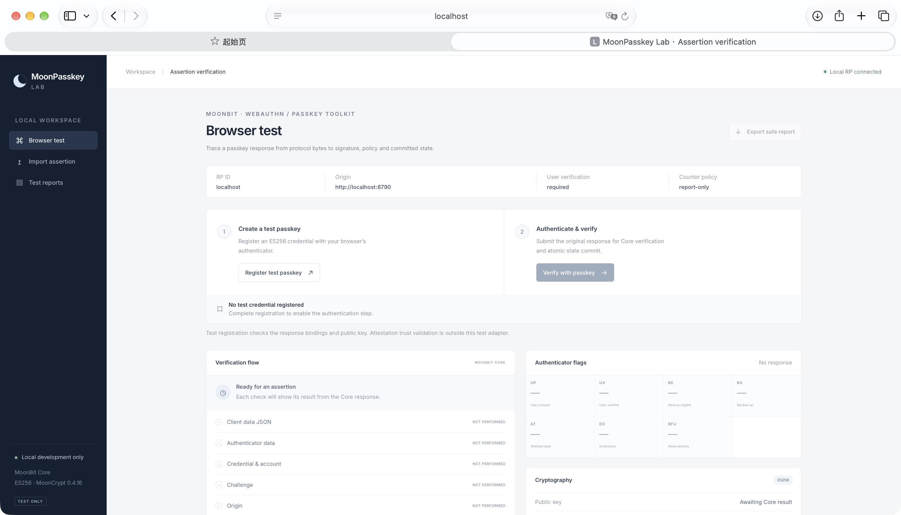
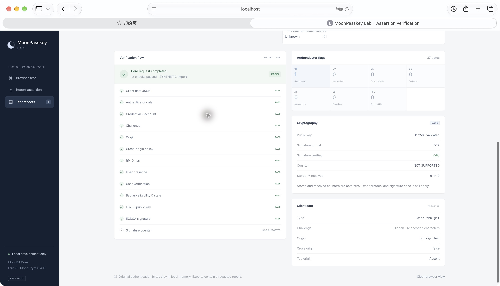
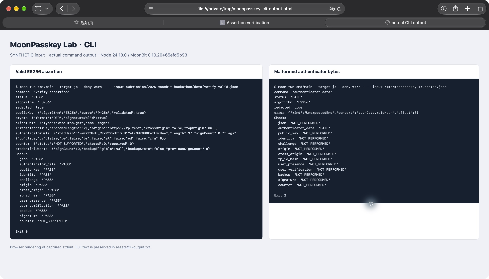
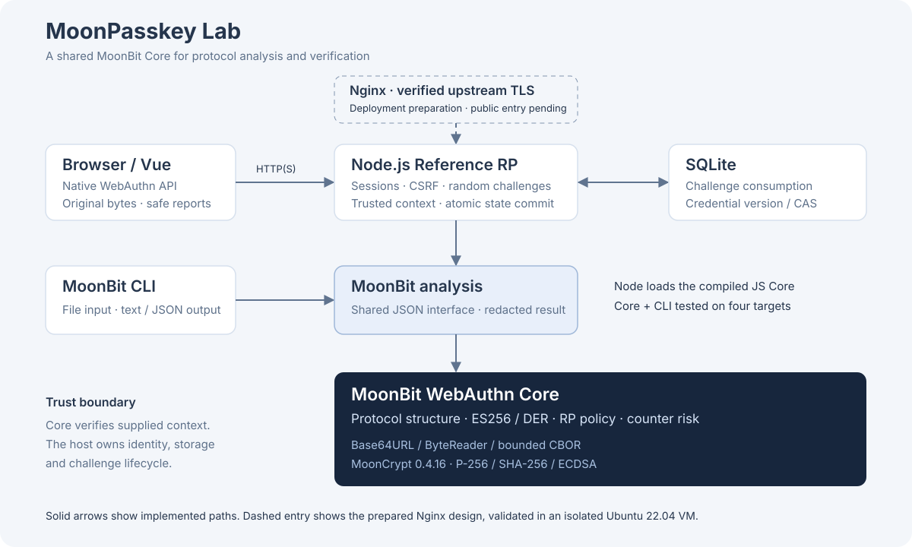

# MoonPasskey Lab

**A MoonBit-powered WebAuthn / Passkey Protocol Analysis and Verification Toolkit**

基于 MoonBit 的 Passkey 协议分析与安全验证工具。从原始认证字节出发，逐项解释协议解析、ES256 验签与 RP 策略检查的结果。

[快速体验](#30-秒快速开始) · [CLI 文档](docs/CLI.md) · [测试记录](docs/DEVELOPMENT.md) · [设备互操作](docs/ASSERTION-INTEROP.md)

## 为什么需要这个工具

一次 Passkey 认证横跨 ClientDataJSON、AuthenticatorData、CBOR / COSE、公钥、签名和服务器状态。开发者需要知道哪个检查失败、失败发生在哪里，以及哪些检查尚未执行。

MoonPasskey Lab 将有界解析、密码学验证、RP 策略与挑战生命周期连接起来。CLI 和 Dashboard 共用 MoonBit Core，支持保存可复现输入、检查错误类型及适用字节位置，并导出脱敏报告，适用于接入调试、协议教学和 MoonBit 基础包集成试验。

## 核心功能

| 能力 | 已实现范围 |
| --- | --- |
| 协议解析 | 严格 Base64URL、ByteReader、有界 CBOR、ClientDataJSON、AuthenticatorData、AttestationObject，保留原始范围 |
| 密码学验证 | ES256 / P-256 公钥参数与曲线点检查、SHA-256、ECDSA、严格 DER Assertion 入口 |
| RP 策略 | Challenge、精确 Origin、RP ID hash、凭证及账户绑定、UP / UV、BE / BS、计数器风险 |
| 状态管理 | 会话与用途绑定、时效、一次性挑战消费、SQLite 事务及凭证 version 条件更新 |
| 开发者入口 | MoonBit CLI、Node.js Reference RP、Vue Dashboard、逐项检查与脱敏导出 |
| 部署工程准备 | Ubuntu 22.04 / Nginx / systemd、后端 TLS 强制验证、只读预检与回滚材料 |

## 产品界面



真实运行的本地界面。首页等待使用者注册测试 Passkey，尚未执行的检查显示 `NOT_PERFORMED`。



上图来自公开 **SYNTHETIC** 夹具的实际 Core 调用。样本 UP=1、UV=0，preferred 策略满足要求，DER 签名有效；计数器 0→0 显示 `NOT_SUPPORTED`。真实设备历史记录另见设备矩阵。

## 典型使用流程

1. 用 CLI 或 Dashboard 导入 Base64URL 编码的原始协议字节。
2. 查看结构、公钥、签名和策略各自的状态，定位错误类型、字段路径及适用 offset。
3. 在本地 Reference RP 中完成测试注册与 Assertion，观察挑战和凭证状态的原子提交。
4. 导出脱敏报告，记录设备环境及来源，按固定输入复现问题。

## 30 秒快速开始

环境就绪后只需一个启动命令。首次安装和构建需要下载依赖，启动时长尚未做基准测量。

前置环境为 Git、Bash、Node.js **24.18.0** 和 MoonBit **0.10.20+65efd5b93**。固定工具链安装命令见部署手册的环境准备章节，macOS / Linux 均应先核对 `node --version` 与 `moonc -v`。隔离 MoonBit 安装需设置对应 `MOON_HOME`。[安装说明](deploy/ubuntu-nginx/README.md)

```sh
git clone --branch main https://github.com/Ksuserkqy/moonpasskey-lab.git
cd moonpasskey-lab
moon update
./scripts/demo.sh
```

打开 [http://localhost:8787](http://localhost:8787)。脚本构建 Core、CLI 和 Dashboard，缺少前端依赖时执行 `npm ci`。本地服务使用内存 SQLite、UV required、counter report-only。端口占用时运行 `DEMO_PORT=8790 ./scripts/demo.sh`。按 Ctrl+C 停止服务，内存数据随进程结束清除。

## CLI 演示

另开终端运行七个公开 SYNTHETIC 场景，每项均检查文本和 JSON 输出。脚本核对预期退出码、检查状态和错误类型。

```sh
./scripts/demo.sh cli

moon run cmd/main --target js -- --input examples/fixtures/verify-valid.json
moon run cmd/main --target js -- --input examples/fixtures/verify-wrong-origin.json --json
```

有效输入退出 0。无效签名、错误 challenge、错误 origin 和未满足 UV required 的输入退出 2。完整 CLI 契约还覆盖参数与文件读取错误。[CLI 文档](docs/CLI.md) · [夹具来源与预期](examples/fixtures/README.md)



截图保留了历史运行时的文件路径；当前命令和夹具路径以上方示例为准。[素材说明](docs/assets/README.md)

## Dashboard 演示

无需设备即可打开 **Import assertion**，选择 Verify assertion，载入 `examples/fixtures/verify-valid.json` 并运行 MoonBit Core。结果页展示签名、flags、challenge / origin / RP ID 检查和计数器状态。依次载入四个负例即可检查拒绝原因。

设备演示使用 **Browser test → Register test passkey → Verify with passkey**。系统凭证操作由使用者亲自完成，成功报告在服务端事务提交后返回。**Test reports → Export safe report** 导出字段允许列表限定的结果，需填写实际环境与来源。导入请求按自身策略分析，本地服务顶部配置用于浏览器流程。[参考 RP 使用说明](docs/REFERENCE-RP.md)

## 技术架构



MoonBit `analysis` 提供统一 JSON 入口。Node 宿主加载其 JS 产物并负责 HTTP(S)、随机挑战、会话和 SQLite；Vue 负责浏览器 API、传输编码和展示。Core 校验可信宿主提供的上下文，RP 负责挑战消费与凭证更新的同库原子提交。[详细架构](docs/ARCHITECTURE.md) · [挑战生命周期](docs/CHALLENGE-LIFECYCLE.md)

## MoonBit 核心实现

| 包 | 责任 |
| --- | --- |
| `base64url` / `bytereader` / `cbor` | 严格解码、安全读取、资源预算、重复键与源范围 |
| `webauthn` | 客户端与认证器数据、attestation 结构、ES256、公钥点、DER 验签和 Assertion 策略 |
| `analysis` / `cmd/main` | 组合验证入口、脱敏报告、文件输入及退出码 |

签名消息使用原始 `authenticatorData || SHA256(clientDataJSON)`。密码学计算复用固定 MoonCrypt `0.4.16` 的纯 MoonBit 路径，文件 IO 使用 `moonbitlang/x@0.5.7`。Core 与 CLI 在 wasm、wasm-gc、js、native 四目标验证。当前网页使用 Node 上的 JS Core。[协议映射](docs/SPEC_MAPPING.md) · [依赖与密码学选择](webauthn/CRYPTO-VECTORS-NOTICE.md)

## 测试与工程证据

已有验收记录为 **631 个独立用例**，按 Core 491、CLI 7、Reference RP / 预检 57、Dashboard / 报告 26、部署 50 统计。跨目标重复运行只计一次；部署套件输出 51 项，其中 1 项为父测试。

四目标 Core / CLI 回归均通过。Ubuntu 22.04 隔离虚拟机中实际验证 Nginx 配置、上游 TLS、Basic Auth、systemd unit 和 Shell 脚本。此前另复验 Dashboard 26 项、CLI 演示、干净源码构建和实际 HTTP / Core 路径，命令与证据范围详见测试记录。[测试记录](docs/DEVELOPMENT.md) · [GitHub Actions](https://github.com/Ksuserkqy/moonpasskey-lab/actions) · [Ubuntu 验证](deploy/ubuntu-nginx/VALIDATION.md)

2026-11-12 的 Safari/macOS 平台 Passkey 历史记录为 UV preferred、实际 UV=true、DER 有效、Core 12 项 PASS。另已归档维护者确认的 Chrome/macOS UV Required 注册及两次 Assertion PASS，DER有效、数据库 COMMITTED，Provider 标签为 1Password、来源 UNKNOWN。Safari required、Google Password Manager、iOS 和公网 HTTPS 验收仍待执行。[设备矩阵与历史报告](docs/ASSERTION-INTEROP.md)

## 标准支持范围

| 依据 | 当前范围 |
| --- | --- |
| W3C WebAuthn Level 3 | 三类核心结构解析、原始字节保留、ES256 Assertion 的签名及 RP 策略；包含固定版本官方向量 |
| RFC 4648 / RFC 8949 | 严格 Base64URL 与有界 CBOR 子集 |
| COSE / ES256、P-256、DER | EC2 / ES256 / P-256 参数与点检查、严格 DER 解码及 ECDSA 验签 |
| Attestation | 通用 Map / Array 结构；none 必须为空 Map，其他格式维持 `FormatNotValidated` |

标准版本、章节、向量来源及许可在映射文档中逐项记录。完整 WebAuthn 注册、attestation 信任链和完整符合性认证尚未实现。[标准与向量](docs/SPEC_MAPPING.md)

## 已知限制

当前算法为 ES256，登记流程为 `none` 最小测试登记。其他 attestation 格式语义、证书链与元数据服务、生产账户及恢复、分布式部署、独立安全审计、性能基准和模糊测试仍待后续工作。参考 RP 用于本地实验。公网部署准备已有隔离验证，真实服务器和 Let's Encrypt 操作尚未执行。[完整限制](docs/LIMITATIONS.md)

## 许可与贡献

项目采用 **Apache-2.0**。第三方代码及官方测试向量沿用各自许可和来源说明。[LICENSE](LICENSE) · [第三方记录](webauthn/CRYPTO-VECTORS-NOTICE.md)

欢迎提交可复现输入、协议问题和文档修正。安全问题请先移除真实凭证与隐私数据。贡献需遵循仓库 AGENTS.md，运行受影响测试，通过 Pull Request 讨论并由维护者验收。[贡献约定](CONTRIBUTING.md)
