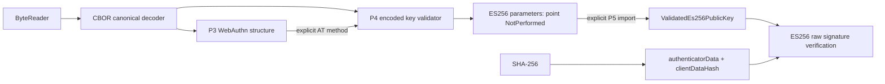
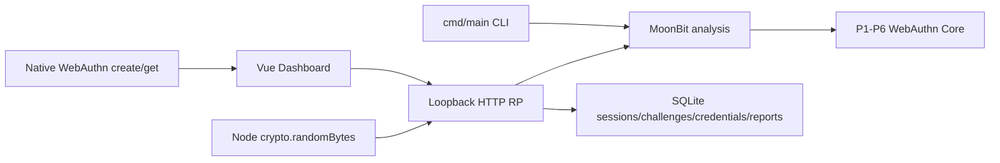

# MoonPasskey Lab 架构

## 阶段状态

截至 2026-11-12，Phase 1 提供 MoonBit `base64url` 与 `bytereader` 包，Phase 2 提供 `cbor` 包，Phase 3 在 `webauthn` 包提供 ClientDataJSON、AuthenticatorData 和 AttestationObject 结构解析，attStmt 支持 Map/Array。Phase 4 增加 ES256 COSE 参数验证，Phase 5 增加 P-256 点导入、SHA-256、raw ES256 验签与 DER assertion 签名入口。Phase 6 增加 ES256 Assertion 的 RP 策略、凭证与账户绑定、计数器风险及状态更新建议。Phase 7 增加统一 analysis JSON 接口、已有 cmd/main 的 CLI、本地 Node/SQLite 参考 RP 和 Vue Dashboard。模块身份为 `ksuserkqy/moonpasskey_lab@0.1.0`，默认目标为 `wasm`。Core 验证调用方提供的可信配置、账户记录和认证字节，参考宿主管理挑战生命周期、事务和浏览器调用。

## 实际目录

```text
moonpasskey-lab/
├── AGENTS.md
├── LICENSE
├── README.md -> README.mbt.md
├── moon.mod
├── moon.pkg
├── moonpasskey_lab.mbt
├── moonpasskey_lab_test.mbt
├── moonpasskey_lab_wbtest.mbt
├── pkg.generated.mbti
├── base64url/
│   ├── moon.pkg
│   ├── base64url.mbt
│   ├── base64url_test.mbt
│   └── pkg.generated.mbti
├── bytereader/
│   ├── moon.pkg
│   ├── bytereader.mbt
│   ├── bytereader_test.mbt
│   └── pkg.generated.mbti
├── cbor/
│   ├── moon.pkg
│   ├── types.mbt
│   ├── semantic_key.mbt
│   ├── decoder.mbt
│   ├── cbor_test.mbt
│   ├── conformance_test.mbt
│   ├── W3C-NOTICE.md
│   └── pkg.generated.mbti
├── webauthn/
│   ├── moon.pkg
│   ├── types.mbt
│   ├── clientdata.mbt
│   ├── authdata.mbt
│   ├── attestation.mbt
│   ├── cose_key.mbt
│   ├── cose_key_test.mbt
│   ├── crypto.mbt
│   ├── assertion_types.mbt
│   ├── assertion_policy.mbt
│   ├── assertion.mbt
│   ├── assertion_fixtures_test.mbt
│   ├── assertion_policy_test.mbt
│   ├── assertion_test.mbt
│   ├── assertion_w3c_test.mbt
│   ├── crypto_test.mbt
│   ├── crypto_der_test.mbt
│   ├── crypto_vectors_test.mbt
│   ├── fixtures/
│   │   └── WYCHEPROOF-LICENSE.txt
│   ├── clientdata_test.mbt
│   ├── authdata_test.mbt
│   ├── attestation_test.mbt
│   ├── w3c_vectors_test.mbt
│   ├── W3C-NOTICE.md
│   └── pkg.generated.mbti
├── cmd/main/
│   ├── moon.pkg
│   ├── main.mbt
│   └── pkg.generated.mbti
├── docs/
│   ├── ARCHITECTURE.md
│   ├── COMPETITIVE_ANALYSIS.md
│   ├── THREAT_MODEL.md
│   ├── SPEC_MAPPING.md
│   ├── LIMITATIONS.md
│   ├── ASSERTION-INTEROP.md
│   └── DEVELOPMENT.md
├── .githooks/
├── .github/workflows/
└── _build/                         # 本地生成且被 Git 忽略
```

根包目前为初始化脚手架。每个子目录用自己的 `moon.pkg` 定义包，完整包名由模块名和相对目录组成。

## 分层与依赖方向

| 层 | 职责 | 当前状态 |
| --- | --- | --- |
| MoonBit Core | 字节转换、结构解析、规则、密码学验证、分析报告 | 已实现基础包、有界 CBOR、协议结构、ES256 密码学、Assertion RP 策略与 analysis 脱敏报告 |
| CLI | 文件与参数输入、调用 Core、报告输出、退出码 | cmd/main 调用 analysis.run_json，支持文本和 JSON |
| Web Dashboard | 输入、flags、逐项验证与 counter 结果 | Vue 3 + TypeScript + Vite，同源调用参考 RP 的 MoonBit bridge |
| 测试基础设施 | 单元测试、集成测试、正负样本、互操作和回归 | 基础包、CBOR、协议解析和集成测试；P7 已验证 Safari/macOS 真实 Passkey，其他设备见矩阵 |

CLI 和 Web Dashboard 共用 MoonBit analysis 接口。协议校验与安全规则归属 Core。Node 宿主实际加载编译得到的 CommonJS 产物，界面展示各步骤的状态和错误信息。

## 当前核心包

### Base64URL

`encode(BytesView, padding?=false)` 返回 `Result[String, Base64UrlError]`。`decode(StringView)` 返回 `Result[Bytes, Base64UrlError]`。编码和解码的二进制大小均限于 1 MiB。编码文本输入限于 1,398,104 个 UTF-16 code units，合法输入全部属于 ASCII。

封装层负责 URL-safe 字母表、大小检查与错误转换。标准库 `moonbitlang/core/encoding/base64` 负责位编解码、padding 格式和末组未使用位校验。公开错误包括 `InputTooLarge`、带零基位置的 `InvalidCharacter` 和 `InvalidEncoding`。最后一项涵盖非法长度、padding 和非零未使用位。

### ByteReader

`ByteReader::new(BytesView)` 创建持有不可变字节视图的游标。`read_u8` 返回 `Byte`，`read_u16_be` 和 `read_u32_be` 返回 `UInt`。`read_bytes(Int)` 返回原缓冲区内的 `BytesView`。所有读取均返回 `Result`。

`position`、`remaining`、`is_empty` 描述相对输入视图的状态。负长度返回 `InvalidLength`，剩余字节不足返回 `OutOfBounds`，两种错误均携带 requested、position、remaining。读取成功才推进游标。整数读取复用 `read_bytes`。

### CBOR

`parse_one(BytesView, offset~=0, profile~=Generic, limits~=Limits::new())` 返回 `Result[Parsed, ParseError]`。`Parsed.consumed` 从指定 offset 起计数，可与下一次调用连续解析。`parse_all` 返回 `Result[Value, ParseError]`，并检查输入已完整消费。每个节点保存完整编码的半开区间 `range[start,end)`，位置相对于传入的整个 BytesView。`encoded_length()` 由区间长度计算。

`ValueKind` 支持 definite-length 的 unsigned、negative、byte string、text string、array、map，以及 boolean、null、undefined 和 simple 值 0–19、32–255。`Unsigned(UInt64)` 保存完整无符号值，`Negative(n)` 表示 `-1-n`，覆盖 CBOR 的完整整数范围。Byte string 保留原输入的 BytesView。Text string 严格校验 UTF-8 并保留 BOM。Map 保留原始 entries 顺序。

`Generic` 接受非最短整数与长度头、任意 map 顺序。`Ctap2Canonical` 在当前支持类型上增加最短头、map 键顺序和最多四层 array/map 嵌套检查。Tags、floats 和 indefinite-length 数据均有明确错误，CTAP profile 另以禁止 tag 和 indefinite-length 的错误报告对应约束。[RFC 8949 §3–4](https://www.rfc-editor.org/rfc/rfc8949.html#section-3) [CTAP 2.3 §8](https://fidoalliance.org/specs/fido-v2.3-ps-20260226/fido-client-to-authenticator-protocol-v2.3-ps-20260226.html#message-encoding)

`Generic` 的 RFC 8949 解码覆盖状态为 `PARTIAL`，当前支持范围为上述 definite-length 类型和 simple 值。IEEE 754 binary16、binary32、binary64 的结构化结果与值模型均待实现。两个 profile 在完整浮点 payload 上返回 `UnsupportedFloat(width=2/4/8)`，截断 payload 返回读取错误。CTAP 保留浮点编码位宽，当前浮点错误表达实现支持状态。[RFC 8949 §3.3](https://www.rfc-editor.org/rfc/rfc8949.html#section-3.3) [CTAP 2.3 §8](https://fidoalliance.org/specs/fido-v2.3-ps-20260226/fido-client-to-authenticator-protocol-v2.3-ps-20260226.html#message-encoding)

两个 profile 均按项目策略拒绝语义重复键。所有已支持类型可作为 map key。内部 `SemanticKey` 自底向上保留类型、去除源范围和编码宽度差异，并将 map 的键值对按内部 total order 标准化，使其等价判断忽略 entries 顺序。`SortedMap` 的 AVL 结构承担去重。CTAP 编码排序单独比较 major type、完整编码长度、编码字节。`Value` 派生的 `Eq` 包含源范围，重复检测使用独立的语义表示。[RFC 8949 §5.6.1](https://www.rfc-editor.org/rfc/rfc8949.html#section-5.6.1)

Array/Map key 按上述三步比较契约处理。CTAP §8 的 Note 说明当前协议未使用 major types 4–6 作 map key，并提示未来使用复杂类型 key 时需重新审视规则。本包接受复合 key 的证据范围为 CBOR 编码检查，CTAP 命令语义和设备互操作仍待对应模块与测试核验。Tags 在 CTAP profile 中按 §8 的独立禁令处理。[CTAP 2.3 §8](https://fidoalliance.org/specs/fido-v2.3-ps-20260226/fido-client-to-authenticator-protocol-v2.3-ps-20260226.html#message-encoding)

资源预算按一次 parse 调用生效。默认输入与单字符串上限均为 1 MiB，array 上限 4096 项，map 上限 1024 对，array/map 嵌套深度 32，节点数 16384。参数须非负，可配置深度的硬上限为 64。CTAP 的四层约束独立执行，消息传输中的 1024 字节默认能力由后续传输上下文处理。

深度按根到当前节点的路径计数。根 Array/Map 为第 1 层，根标量为 0 层，Map 的 key 和 value 中的容器均计数，兄弟容器各自计算。`Generic` 使用配置的深度预算。`Ctap2Canonical` 同时检查项目预算和 CTAP 四层上限，`max_depth=64` 仍会拒绝第 5 层，较小预算可进一步收紧。

`ParseError` 提供零基 offset、嵌套 context 和可区分的错误种类，覆盖截断、非法头、UTF-8、重复键、编码 profile、资源限制及 unsupported 类型。P3 的 AuthenticatorData 和 AttestationObject 复用此解码器，P4 提供显式 ES256 参数验证，P5 提供单独的密码学入口。

#### CBOR 实现状态

| 范围 | 状态 | 当前契约 |
| --- | --- | --- |
| RFC 8949 Generic 解码整体 | `PARTIAL` | 覆盖已列 definite-length 类型和 simple 值的子集 |
| Definite major types 0–5、已列 simple 值 | `IMPLEMENTED` | 有界读取、UTF-8、完整整数域与源范围 |
| 语义重复键检测 | `IMPLEMENTED` | 两个 profile 均按项目策略拒绝，保留类型差异 |
| Ctap2Canonical 整体 | `PARTIAL` | 编码检查覆盖当前支持类型 |
| CTAP 最短整数与长度头 | `IMPLEMENTED` | 对整数及 major types 2–5 的长度执行最短表示检查 |
| CTAP map 键排序 | `IMPLEMENTED` | major type、完整编码长度、原始字节三步比较 |
| CTAP 四层深度与 tag/indefinite 禁止检测 | `IMPLEMENTED` | array/map 的 key 和 value 均计深度，调用方资源上限可进一步收紧 |
| IEEE 754 binary16/32/64 结构化结果与值模型 | `NOT_IMPLEMENTED` | 完整 payload 返回 `UnsupportedFloat`，截断返回读取错误 |
| Generic tag 和 indefinite-length 结构解析 | `NOT_IMPLEMENTED` | 识别相应头后报告 unsupported |
| CTAP 命令语义与设备互操作验证 | `NOT_IMPLEMENTED` | ES256 参数约束另由 P4 入口实现 |

P2 验收基线为 107 个测试，其中 CBOR 为 63 个。`conformance_test.mbt` 包含 W3C 固定版本的 77 字节 ES256 COSE_Key 官方规范示例，以及项目合成的边界和重排变异。P3 首次验收新增 99 个协议解析黑盒测试，全仓库当时为 206 个。审查修正继续增加外层字段拒绝、Array statement 与 §16 官方向量回归；当前数量和四目标实际结果见 `DEVELOPMENT.md`。示例来源与许可记录见 `SPEC_MAPPING.md` 和 `cbor/W3C-NOTICE.md`。

### WebAuthn 协议结构解析

`webauthn` 包依赖现有 ByteReader 和 CBOR，三个入口均接受原始 `BytesView`、可选 `@cbor.Limits`，返回 `Result[结构化结果, ParseError]`。统一错误保存字节 offset、嵌套字段 context 和 `ErrorKind`；CBOR 错误种类通过 `Cbor` 保留，截断错误保留请求长度与剩余长度。

| 入口 | 结果 | 已实现范围 |
| --- | --- | --- |
| `parse_client_data` | `ClientData` | UTF-8、JSON 语法、顶层对象、必需字段与可选字段类型、重复成员、原始字节和顶层成员范围 |
| `parse_authenticator_data` | `AuthenticatorData` | 固定 37 字节结构、flags、UInt32 计数器、AT、ED、CBOR 完整消费和原始范围 |
| `parse_attestation_object` | `AttestationObject` | canonical CBOR 外层 Map、限定三个字段、Map/Array statement、内嵌 authData、none 空 Map 和状态标记 |

ClientDataJSON 由有界字节扫描器检查 JSON 容器、数字语法、字符串边界和预算，单个字符串 token 才交给标准库 `core/json` 解码。所有对象按解码后的成员名拒绝重复，包括转义等价名称和未知字段中的嵌套对象；未知顶层成员保留名称及 key/value token 范围，不创建完整的未知 JSON 对象树。输入首先经过严格 UTF-8 校验，解析时跳过一个初始 UTF-8 BOM，`ClientData.raw` 仍完整保留它。未配对的 Unicode surrogate escape 按项目策略拒绝。

`type_`、`challenge`、`origin` 必须存在且为字符串，空字符串在结构层可通过。`cross_origin : Bool?` 和 `top_origin : String?` 保存缺省与显式值的区别。操作类型取值、challenge 解码与匹配、origin 信任及两个可选字段之间的关系均不在此入口验证。后续哈希必须使用 `ClientData.raw`，不能重新序列化字段替代原始字节。[WebAuthn §5.8.1](https://www.w3.org/TR/2026/REC-webauthn-3-20260825/#dictdef-collectedclientdata)

AuthenticatorData 复用 ByteReader 读取 `rp_id_hash`、flags 与大端 `sign_count`。flags 保留原始字节、UP/UV/BE/BS/AT/ED 和 RFU 位，拒绝 BS 为真而 BE 为假的组合。保留 RFU 而不拒绝是本项目结构解析的兼容策略；它不声明输入满足 authenticator 生成时 RFU 必须为零的要求，也不将标志视为经过验证的安全属性。AT 读取 AAGUID、两字节 credential ID 长度、ID 和 CBOR map 公钥；长度上限为 1023，零长度只在结构层接受。ED 要求 map，键按扩展标识符的最多 32 octets、限定可打印 ASCII 规则检查，值保留原始 CBOR。[WebAuthn §6.1、§6.5.1、§9.1](https://www.w3.org/TR/2026/REC-webauthn-3-20260825/#sctn-authenticator-data)

AttestationObject 保留完整 CBOR 树及原始字节。外层 Map 只允许且必须包含 `fmt`、`authData`、`attStmt`：非 text 键与未知字段均拒绝，未知字段错误定位到键的编码起点。`fmt` 必须为符合 §8.1 标识符规则的 text，`authData` 必须为 byte string 且解析结果包含 AT。`attStmt` 接受 text-keyed Map 或 Array，并保留原始 CBOR Value 及范围；statement Map 内的未知字段继续保留。`fmt="none"` 仍只接受空 Map，状态为 `NoneStructureChecked`；其他格式的 Map/Array 均为 `FormatNotValidated`。Array 的通用结构支持不表示完成了 compound 或其他格式的语义与签名验证，整体协议覆盖仍为 `PARTIAL`。ClientDataJSON 的未知字段兼容策略不受此处外层限制影响。[WebAuthn §6.5.4、§8.1、§8.7](https://www.w3.org/TR/2026/REC-webauthn-3-20260825/#sctn-generating-an-attestation-object)

#### 编码、预算与位置契约

WebAuthn 的外层对象、公钥及扩展均使用现有 `Ctap2Canonical` profile。WebAuthn §2.4 的 decoder SHOULD 作为本项目严格拒绝非 canonical 编码的选择；此选择只应用于协议入口，P2 `Generic` 行为不变。每个 CBOR 树仍受独立四层 array/map 上限约束，字节串中的内嵌 CBOR 从自己的根计深度。[WebAuthn §2.4、§3](https://www.w3.org/TR/2026/REC-webauthn-3-20260825/#sctn-all-conformance-classes)

三个入口复用 `@cbor.Limits`，默认输入与单字符串均为 1 MiB、array 为 4096 项、map 为 1024 对、深度 32（硬上限 64）、节点 16384。JSON 的单字符串预算按不含引号的原始编码字节计，转义序列计入；对象的 key 和 value 都计节点。AuthenticatorData 的公钥与扩展共享节点预算；AttestationObject 的外层 CBOR 节点也从同一次调用预算扣除后再解析内嵌 authData。容器项数按各容器检查，不因 AT/ED 分支重置总节点预算。内嵌 CBOR 的 `max_values` 错误所报 `limit` 是扣除前面对象后的剩余预算。

所有源范围均为 `[start,end)`。每个公开入口的错误 offset 相对于它接收的完整输入视图；AttestationObject 将内嵌错误及重复键等错误附带的位置一起换算到外层。结果中的 `auth_data` 字段范围保持相对于 `auth_data.raw`，其外层基址由 `auth_data_payload_range.start` 提供；`auth_data_range` 则包括 byte string 编码头。调用者可将基址加到公钥或扩展范围，在外层字节中定位它们。

### ES256 Credential Public Key 参数验证（P4）

`validate_es256_credential_public_key(BytesView, limits? : @cbor.Limits)` 返回 `Result[Es256PublicKeyParameters, ParseError]`。入口要求恰好一个完整 canonical CBOR Map，复用现有 decoder 的预算、重复键与尾随检查，不接受来源不明的 `Value`，因此调用方不能通过 Generic 解码结果绕过 canonical 检查。

结果保存检查后的 `kty=2`、`alg=-7`、`crv=1`、原始 x/y 字节、完整 key 编码和各参数值的源范围。x/y 必须各 32 字节且小于 P-256 素数，保留前导零。P4 结果中的 `CurvePointValidation.NotPerformed` 始终描述这一次参数检查，曲线方程检查由 P5 的显式导入入口执行。

AT 结果新增 `AttestedCredentialData::validate_es256()` 显式方法。它只查看 P3 已由 canonical decoder 产生的不可变、受预算约束的 Map；不重置或扩大预算。`parse_authenticator_data` 和 `parse_attestation_object` 保持原有结构解析行为，其他算法仍能结构解析，调用语义入口才报告 `UnsupportedAlgorithm`。两层之间没有隐式验证或自动信任提升。



独立字节入口的 range/error offset 相对于传入 view；AT 方法的范围相对于 `authData.raw`，`raw` 仅包含 key 编码。位于 AttestationObject 时，调用方加 `auth_data_payload_range.start` 得到外层位置。参数值错误定位到 value 头，禁止/未知 label 定位到 key 头，缺失参数定位到 key Map 起点，context 指明字段或 parameter 下标。

错误复用 `ParseError/ErrorKind`，区分算法、类型、曲线、坐标长度、坐标范围、压缩 y、私钥 d、已知禁止 optional、未知不支持参数以及原始 CBOR 错误。错误不回传私钥字段内容。检查顺序是 CBOR、label 策略、alg、kty、crv、x、y；未知参数拒绝属于当前严格支持范围，不是对全部 COSE 的违规判断。

### 密码学验证（P5）

`webauthn/crypto.mbt` 通过固定版本 `moonbitstack/mooncrypt@0.4.16` 调用 P-256、SHA-256 和 ECDSA。项目适配层负责参数来源、格式、资源与错误契约，椭圆曲线运算由后端执行。当前生产调用路径使用纯 MoonBit 包，在 native、js、wasm、wasm-gc 上共享实现。候选调查、固定工具链探针与最终仓库验收分别记录在开发文档中。

| API | 结果与职责 |
| --- | --- |
| `import_es256_public_key(Es256PublicKeyParameters)` | 返回 `Result[ValidatedEs256PublicKey, CryptoError]`，导入 P-256 affine 点并检查曲线方程 |
| `ValidatedEs256PublicKey::parameters()` | 返回原始 P4 参数记录及源范围 |
| `sha256(BytesView)` | 对完整输入 view 计算固定 32 字节 digest，支持空输入 |
| `verify_es256_signature(key, message, signature)` | 验证 raw 64 字节 `R || S` 签名，返回 `Result[Bool, CryptoError]` |
| `build_webauthn_assertion_signed_data(authenticator_data, client_data_json)` | 返回原始 authData 拼接原始 clientDataJSON 的 SHA-256 |
| `verify_webauthn_es256_assertion_signature(key, authData, clientDataJSON, signature_der)` | 严格解码 WebAuthn DER 签名，构造签名消息并验签 |

`ValidatedEs256PublicKey` 具有私有后端字段，只能通过导入入口取得。导入接收 P4 已检查的参数记录，先前的 32 字节与 `< p` 约束持续生效，然后由 MoonCrypt 检查曲线方程。Affine 输入及 P-256 的 cofactor-one 属性确立有限有效公钥点。`parameters()` 保留的 P4 记录继续显示 `NotPerformed`，而外层类型记录已执行的点检查层级。

MoonCrypt 0.4.16 的 `PublicKey::of_xy` 会接受部分与合法点模 p 同余的非规范坐标，因此 P4 的严格域范围检查是导入前置条件。项目回归覆盖公开 issue #1 的 `x=p` 输入，确保其在 P4 坐标范围检查处返回 `InvalidCoordinate`。后端未经本项目修改。[MoonCrypt issue #1](https://github.com/moonbitstack/mooncrypt/issues/1)

Raw 验签先检查恰好 64 字节，再检查 `1 <= R,S < n`，R/S 按固定 32 字节无符号大端解释。`CryptoError` 区分长度、非法标量及公钥导入错误，合法编码的签名验证失败返回 `Ok(false)`。后端的 message-based verify 对所传 message 执行一次 SHA-256，适配层直接传入 message。Low-S 和 high-S 均接受。[RFC 9053 §2.1](https://www.rfc-editor.org/rfc/rfc9053.html#section-2.1)

签名消息构造独立计算 `SHA256(clientDataJSON)`，将结果追加到原始 authenticatorData。输入 view 的空白、JSON 顺序、转义及字节边界都会参与哈希，字节级入口接受空 view。拼接前检查 Int32 长度加法边界。`verify_webauthn_es256_assertion_signature` 使用构造后的消息执行 ES256 验签。[WebAuthn §7.2](https://www.w3.org/TR/2026/REC-webauthn-3-20260825/#sctn-verifying-assertion)

WebAuthn §6.5.5 规定 authenticator 的 ES256 wire 签名采用 ASN.1 DER。assertion 入口复用 MoonCrypt ASN.1 解析器，限制编码为 8 至 72 字节，严格检查一个 SEQUENCE 中恰好两个最短、非负 INTEGER，并要求完整消费输入。非最短长度、indefinite 长度、冗余符号零与负数均返回 `InvalidSignatureEncoding`。必要的正数符号零被移除，32 字节以内的短整数左补零，得到后端所需的 raw64。零、超过 32 字节的正数幅值或不小于群阶的 R/S 返回 `InvalidSignatureScalar`。通用 `verify_es256_signature` 继续接收 COSE raw64 签名。[WebAuthn §6.5.5](https://www.w3.org/TR/2026/REC-webauthn-3-20260825/#sctn-signature-attestation-types)

### ES256 Assertion 与 RP 策略（P6）

`verify_webauthn_es256_assertion(request, credential, policy, limits?)` 返回 `Result[AssertionVerificationResult, AssertionVerificationError]`。实现分为 `assertion_types.mbt` 的公开数据模型、`assertion_policy.mbt` 的配置与客户端/身份检查、`assertion.mbt` 的认证器数据、验签与计数器流程。它复用 P3 解析、P5 DER 验签、已有 Base64URL 和 MoonCrypt 的安全字节比较。[WebAuthn §7.2](https://www.w3.org/TR/2026/REC-webauthn-3-20260825/#sctn-verifying-assertion)

| 类型 | 输入与职责 |
| --- | --- |
| `AssertionVerificationRequest` | 原始 clientDataJSON、authenticatorData、DER signature、解码后的 credential ID、可选 userHandle，以及可信的本次 expected challenge 与账户识别模式 |
| `AssertionCredentialRecord` | 调用方从已选账户取得的可信 credential ID、账户 userHandle、`ValidatedEs256PublicKey`、历史 signCount 和可选 backupEligible |
| `AssertionVerificationPolicy` | 精确 origin/topOrigin/credential ID 允许列表、可信 RP ID、UV 要求、跨域开关和 counter 风险策略 |
| `AssertionVerificationResult` | 原始字节与范围仍可追溯的客户端/认证器解析结果、counter 风险状态，以及凭证状态更新建议 |
| `AssertionVerificationError` | 字段 context、可选原始字节 offset、配置/身份/策略/计数器错误及原样包装的 `ParseError` 或 `CryptoError` |

策略构造器的默认值为 UV `Preferred`、跨域关闭、counter `ReportOnly`，topOrigin 与 credential ID 允许列表为空。Origin 必须由调用方显式配置。非空 credential ID 列表对应 `allowCredentials`，响应 ID 同时匹配列表与可信记录。`Identified` 模式允许响应省略 userHandle，存在时必须匹配账户句柄。`Discoverable` 模式要求响应带有匹配的句柄，账户查找由调用方在验证前完成。

验证按配置与预算、凭证身份、客户端 JSON 与策略、authenticatorData 与策略、DER 签名、counter 风险、状态建议的顺序执行。客户端 `type` 必须为 `webauthn.get`。Challenge 要求预期与收到值均非空，复用 Base64URL 检查字符、末组位及规范编码，并拒绝 padding。收到的字符串必须等于预期字节的无 padding 编码，解码字节也通过 `@spec.eq` 比较。该比较同样用于 RP ID hash、credential ID 与 userHandle，内容比较读取完整等长输入。

Origin 和 topOrigin 按配置原文精确匹配，允许合法 Unicode 或原生客户端 origin 字符串。配置字符串先检查 UTF-16 配对与 UTF-8 字节预算，避免固定工具链编码器对未配对 surrogate 的跨目标差异。`crossOrigin=true` 要求显式开启跨域。topOrigin 存在时还要求 crossOrigin 显式为 true，并匹配独立顶层允许列表。允许跨域时 topOrigin 仍可省略。[WebAuthn §5.8.1、§7.2、§13.4.9](https://www.w3.org/TR/2026/REC-webauthn-3-20260825/#dictdef-collectedclientdata)

RP ID 配置支持 ASCII 域名标签及 localhost，每个标签1至63字符，总长度不超过253，拒绝空标签、首尾连字符、末尾点及 scheme/port/path 等 URL 字符。配置原文大小写保留，使用 `SHA256(UTF8(expected_rp_id))` 与32字节 rpIdHash 比较。该配置语法子集不执行 Public Suffix List、IDNA 或 origin 与 RP ID 的域名授权推断，注册与浏览器适用性由调用方保证。§10.1.1 AppID 扩展的特殊哈希路径未实现，本入口只验证配置的 RP ID 哈希。[WebAuthn §10.1.1](https://www.w3.org/TR/2026/REC-webauthn-3-20260825/#sctn-appid-extension)

Assertion 要求 UP=true，UV 仅在 `Required` 时必须为 true，`Preferred` 与 `Discouraged` 保留实际 UV 供调用方使用。BS⇒BE 继续由解析器检查，已登记 BE 存在时必须与当前 BE 一致。P6 严格拒绝 AT 和非零 RFU 位，P3 通用结构解析仍保留其原有行为。ED 输出经过既有预算与 CBOR 结构校验，当前 RP 按 §7.2 step23 选择忽略扩展语义，并将原始值保留在结果中。[WebAuthn §6.1、§6.1.3、§7.2](https://www.w3.org/TR/2026/REC-webauthn-3-20260825/#sctn-authenticator-data)

`CounterStatus` 分为 `NotSupported`（0→0）、`Advanced`（新值更大）和 `NonIncreasing`（至少一值非零且新值不增）。签名通过后才评估 counter。`ReportOnly` 返回风险并建议保留历史最大计数，`Reject` 返回 `CounterNonIncreasing`。非递增只能作为异常信号。成功的 `AssertionCredentialUpdate` 保存旧计数、旧 BE、建议计数与当前 BS，已存 BE 为 `None` 时仍保留 `None`，避免推断未知注册属性。[WebAuthn §6.1.1、§7.2](https://www.w3.org/TR/2026/REC-webauthn-3-20260825/#sctn-sign-counter)

JSON 和 authenticatorData 分别复用同一个 `@cbor.Limits` 配置。原始字段、预期 challenge、credential ID、userHandle 与公钥编码在额外处理前受输入预算检查，允许列表项数受 `max_array_items` 约束，配置字符串受 `max_string_bytes` 约束。Challenge 另受 Base64URL 固定1 MiB二进制上限约束，credential ID 为1至1023字节，账户与响应 userHandle 为1至64字节，DER 签名继续由 P5 限制为8至72字节。

配置错误没有输入 offset。客户端语义错误定位到对应 JSON value token 的原始字节起点，authenticatorData 错误定位到其字段范围。包装的解析错误保留内层 offset 与 context。只有完整成功结果包含更新建议。挑战生成、熵、有效期、一次性消费及凭证持久化由调用方管理，建议在事务或 revision/CAS 中重新核对历史状态、原子消费挑战并提交更新。[WebAuthn §13.4.3](https://www.w3.org/TR/2026/REC-webauthn-3-20260825/#sctn-cryptographic-challenges)

§7.2 step24.3 的 `uvInitialized` 生命周期及初始化时可能需要的额外认证因子由调用方实现；本更新建议只覆盖 counter 与 BE/BS。部署具有额外安全检查时应先完成这些检查。真实设备互操作的执行状态与可复现步骤见独立记录。[WebAuthn §7.2](https://www.w3.org/TR/2026/REC-webauthn-3-20260825/#sctn-verifying-assertion) · [设备互操作记录](ASSERTION-INTEROP.md)

## 后续核心模块职责

| 模块 | 计划契约 |
| --- | --- |
| COSE 扩展 | 现有 ES256 参数入口以外的算法、类型和曲线需单独实现与测试 |
| Cryptography 扩展 | 其他算法、attestation 签名与证书链需要对应规范、后端调查及独立测试 |
| Security rules 扩展 | P6 之外的算法、扩展语义和业务规则需要独立标准依据、策略与测试 |
| Analysis/report | 组合解析、验证和 unsupported 状态，产生可追溯结果 |

对 `clientDataJSON` 的 SHA-256 必须使用原始输入字节。结构解析、签名验证、信任评估和认证结论需要分别记录状态。CTAP2 canonical CBOR 策略应在对应协议上下文应用。[WebAuthn Level 3 §6–7](https://www.w3.org/TR/2026/REC-webauthn-3-20260825/)

## 依赖选择

使用随工具链提供的 Apache-2.0 `moonbitlang/core`。项目与 CI 固定 `0.10.20+65efd5b93`，P5 在隔离安装的相同工具链上验收。P3/P4 部分历史本地检查使用 `0.10.21+f125caab5`，详细记录见 `DEVELOPMENT.md`。Base64URL、ByteReader、CBOR 与 JSON 字符串解码继续复用现有包及标准库。CBOR 的 WebAuthn 反向导入仅供官方 fixture 的测试，生产依赖保持单向。

P5 首次增加外部依赖 `moonbitstack/mooncrypt@0.4.16`，对应 Git tag `v0.4.16` 的提交 `ad5f2e797c60a87e1f6541d1d6ba0dd94df70d9a`。实际解析的间接依赖为 moonbase 0.4.5、moondate 0.1.7、moonseed 0.1.3 和 moonbitlang/x 0.5.7，许可证均为 Apache-2.0。选用的 hash/sha2、sign/ecdsa 及其实际生产依赖路径没有引入平台 FFI。

依赖审查核对了源代码、公钥与签名边界、公开问题及归档身份。选定后端的隔离探针在固定工具链四目标各通过 275 项独立测试，并完成带 `--deny-warn` 的检查、构建和运行。最终仓库全套测试与 CI 结果单独记录。未找到适用于该后端版本的独立第三方安全审计报告，采用范围与公开坐标问题的防护条件详见 `LIMITATIONS.md`。候选比较与探针证据见 `DEVELOPMENT.md`。

## Phase 7 集成边界



`analysis/` 提供两个公开字符串 JSON 入口。run_json 仅输出脱敏报告，run_host_json 供可信宿主登记测试凭证并生成内部记录。ClientData、AuthenticatorData、Assertion 分析和完整 Assertion 验证复用既有接口。新增 register-test 明确只接受 none attestation，完成最小登记所需的 challenge、origin、RP ID、flags、凭证 ID 与 ES256 曲线点检查。attestation_trust 保持 NOT_PERFORMED。P1–P6 源码与协议语义保持原状。

`reference-rp/` 使用 Node 内置 crypto、http/https 和 sqlite。会话、挑战摘要、公开凭证状态及脱敏报告进入同一 SQLite 数据库，默认内存运行。Core 验证后在 BEGIN IMMEDIATE 内重验挑战并以凭证 version 条件更新，版本冲突重新读取并完整重新验证。挑战消费与状态修改在同一事务提交。

`dashboard/` 只执行原生浏览器 WebAuthn 调用、ArrayBuffer 传输转换和结果展示。原始 clientDataJSON 从浏览器返回值直接编码，服务端解码后由 MoonBit 完成哈希与验签。静态文件由 RP 同源提供，依赖和字体在构建时本地打包。Dashboard 对外导出使用字段允许列表脱敏。

新增直接依赖 moonbitlang/x@0.5.7 用于 CLI 文件 IO，该版本已经由 MoonCrypt 的既有依赖树引入。固定 MoonCrypt 0.4.16 和工具链保持原版本。JS 集成通过真实编译产物的 HTTP 测试验证，其他目标仍可独立使用 Core 和 CLI。[CLI](CLI.md) · [参考 RP](REFERENCE-RP.md) · [事务机制](CHALLENGE-LIFECYCLE.md)
