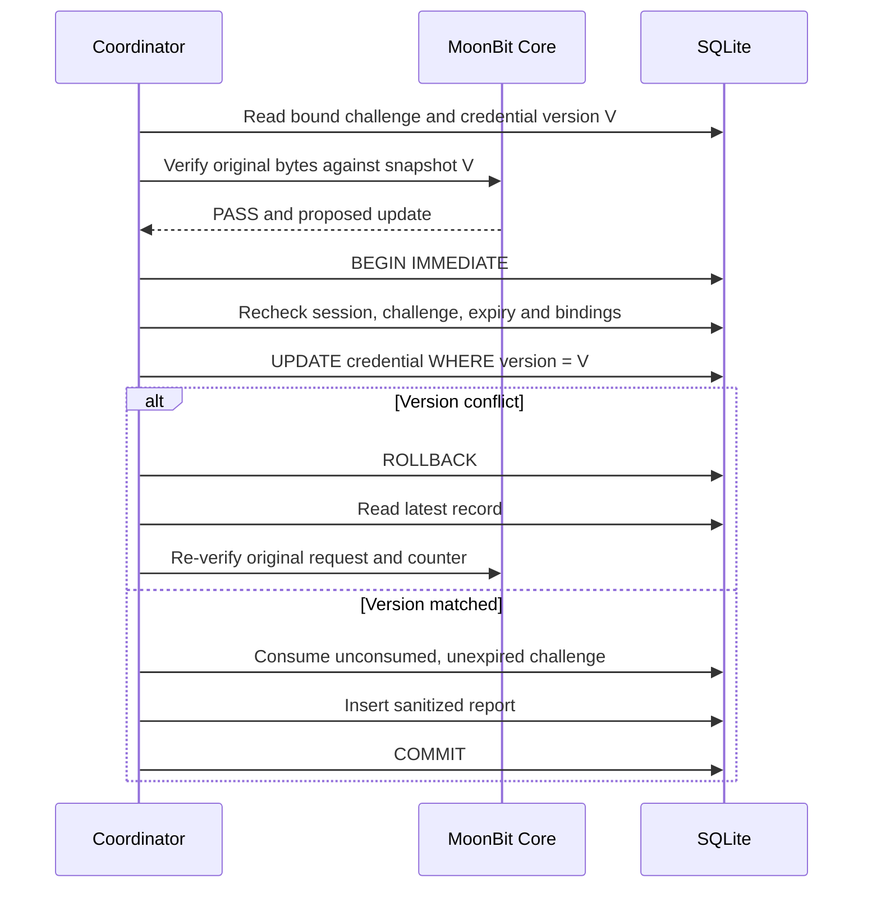

# Challenge 生命周期与并发提交

Phase 7 的参考实现位于 `reference-rp/store.mjs` 和 `coordinator.mjs`，使用 Node 24 内置安全随机源与 SQLite。MoonBit Core 继续验证调用方给定的可信预期值。服务端负责时钟、会话、挑战和事务。

## 生成与绑定

挑战由 `crypto.randomBytes(32)` 产生并编码为无 padding Base64URL。数据库保存原始随机字节的 SHA-256 摘要，原始 challenge 只在创建响应和随后提交请求中传递。会话 token、CSRF token 和账户 userHandle 也使用安全随机源。随机源失败会中止请求。[Node.js 24.18 crypto.randomBytes](https://nodejs.org/download/release/v24.18.0/docs/api/crypto.html#cryptorandombytessize-callback)

挑战行保存 challenge_hash、session_id、user_id、rp_id、origin、created_at、expires_at、consumed_at 和 purpose，同时固定本次 UV 与 counter policy。注册与 assertion 使用不同 purpose。默认有效期5分钟，可配置为1秒至15分钟。

提交包含 challengeId 与原始 issued challenge。宿主首先核对摘要和绑定，再将该 challenge 作为 expectedChallenge 交给 Core。Core 从原始 clientDataJSON 解码 challenge 并验证一致性。请求提供的策略或凭证记录不能替换可信数据库上下文。

已过期会话、challenge 过期、已消费、跨会话/账户、purpose/RP ID/origin/摘要不匹配分别返回类型化错误。失败验证保留未消费挑战，重试仍需满足有效期与全部绑定。每个会话同时最多32个有效未消费挑战，最多16个登记凭证。

## Assertion 提交边界



计数、BE/BS、凭证 version、挑战消费和脱敏报告在同一个数据库事务提交。条件更新影响行数必须为1。挑战消费同时要求 consumed_at 为空且未过期。任何失败回滚整个事务。注册同样将凭证插入、挑战消费和报告插入放进同一个事务。

版本冲突后重新读取最新凭证，将同一原始认证数据交给 Core 完整重新验证，最多4次。ReportOnly 对最新计数重新计算风险并保留高水位。Reject 对最新状态的非递增关系返回失败。BS 可在有效请求之间变化，BE 必须符合已登记值。报告中的 received 计数保留原始观察值，WARNING 只表示计数风险。[WebAuthn Level 3 REC 2026-08-25 §6.1.1、§7.2](https://www.w3.org/TR/2026/REC-webauthn-3-20260825/#sctn-verifying-assertion)

## 可执行竞争测试

`reference-rp/test/race.mjs` 创建独立 worker threads，`race-worker.mjs` 在每个 worker 打开独立 SQLite 连接，通过共享内存屏障确保两个请求都已读取同一版本，再释放较大计数请求先提交。测试覆盖同一 challenge 的双提交、不同 challenge 的乱序计数、ReportOnly、Reject、版本重试、BS 更新与 BE 不一致。测试中的数据库竞争实际执行。合成协议夹具与真实设备记录分别标注来源。

```sh
moon build analysis --target js --deny-warn
npm --prefix reference-rp test
```

SQLite 采用 foreign_keys、busy_timeout、文件库 WAL 和同步提交。默认数据库位于内存，显式设置 REFERENCE_RP_DB 才保存文件。文件权限为0600，新目录0700。进程中止时 SQLite 提供事务恢复，内存库随进程退出消失。跨数据库分布式事务、账户恢复、长期存储清理和生产可用性尚未实现。
