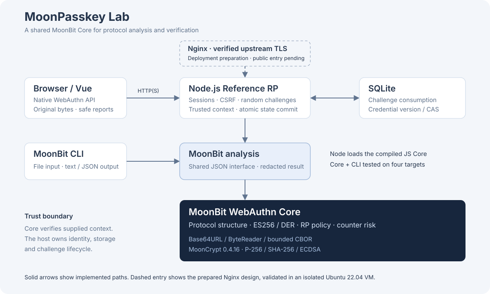
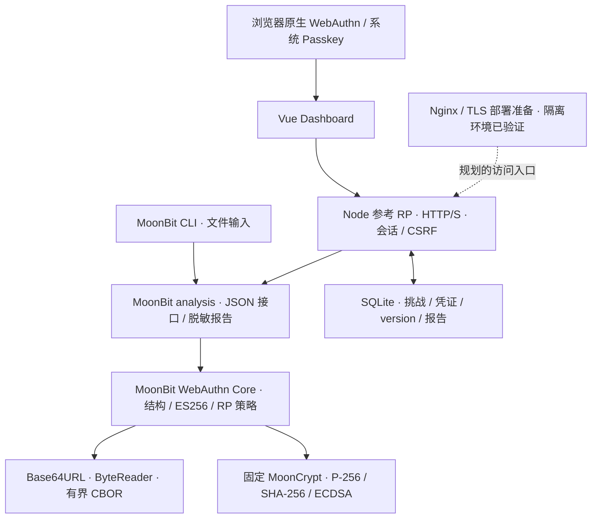

# 架构｜MoonBit 负责协议，宿主负责生命周期

MoonPasskey Lab 的协议解析与验证集中在 MoonBit Core。CLI、Node 参考 RP 和 Vue Dashboard 围绕同一 analysis 接口连接输入与结果。以下为申报用简图，详细契约见 [仓库架构文档](../../docs/ARCHITECTURE.md)。

## 模块责任

| 模块 | 负责的工作 |
| --- | --- |
| `base64url` / `bytereader` / `cbor` | 编码、边界读取、有界解析、重复键与源范围 |
| `webauthn` | ClientDataJSON / AuthenticatorData / AttestationObject；ES256 参数、公钥点、DER 验签与 Assertion 策略 |
| `analysis` | 组合既有入口、统一 JSON 契约、输出分层检查与脱敏报告 |
| `cmd/main` | 文件输入、文本 / JSON 输出和退出码 |
| `reference-rp` | HTTP(S)、安全随机挑战、可信账户记录、会话与 CSRF、SQLite 事务 |
| `dashboard` | 原生 `navigator.credentials.create/get`、字节传输转换、分析与结果展示 |
| `deploy/ubuntu-nginx` | Nginx / systemd 配置、离线预检、TLS 生成和回滚工具及隔离验证 |

网页当前通过 Node 加载 MoonBit 编译后的 JS Core，浏览器直接 Wasm 集成尚未实现。Core 与 CLI 已在 native、js、wasm、wasm-gc 验证。选用的密码学生产路径为纯 MoonBit，固定工具链 `0.10.20+65efd5b93`、MoonCrypt `0.4.16`；参考宿主固定 Node.js `24.18.0`。

## 一次 Assertion 如何经过系统

1. 参考 RP 生成随机挑战，将其与会话、用途和有效期绑定，再向浏览器返回 options。
2. 使用者完成系统认证。Dashboard 直接传输原始 `clientDataJSON`、`authenticatorData`、DER signature、credential ID 与可选 userHandle 的 Base64URL 编码。
3. RP 从可信数据库构造预期 challenge、账户凭证和策略。MoonBit 依次检查输入预算、身份、客户端策略、RP ID hash / flags、DER 签名与计数器风险。
4. 签名消息使用原始 `authenticatorData || SHA256(clientDataJSON)`，不会由解析字段重建 JSON。成功结果带状态更新建议，失败保留适用字段路径与字节位置。
5. RP 在 `BEGIN IMMEDIATE` 事务中重新核对挑战，以凭证 version 条件更新；冲突后重新读取并完整验证。挑战消费与凭证更新同库原子提交，提交完成才返回成功。

Core 不持有数据库或服务端挑战。它校验可信调用方提供的上下文；随机性、存储、账户查找和提交由宿主实现。[挑战生命周期](../../docs/CHALLENGE-LIFECYCLE.md)

## 报告与信任边界

公开分析接口 `run_json` 输出脱敏报告；`run_host_json` 额外返回测试登记所需的内部记录，只供可信宿主使用。HTTP 输出和 Dashboard 导出再次按字段允许列表过滤，不导出完整挑战、credential ID、userHandle、公钥、签名或原始认证字节。

结构解析、ES256 参数、公钥点、签名与策略分别表达检查层级。`none` 测试登记只完成最小绑定与公钥检查，attestation 信任保持 `NOT_PERFORMED`。导入分析不产生数据库提交；合成演示也不增加真实设备覆盖。

## 部署图的证据范围

Nginx / TLS 配置已经在 Ubuntu 22.04 隔离虚拟机中，用临时端口、合成证书与认证材料验证。图中的访问入口表示部署设计，尚无已验收的公网域名或真实服务器；Let's Encrypt 申请 / 续期和新设备 HTTPS 流程未执行。[部署验证](../../deploy/ubuntu-nginx/VALIDATION.md) · [能力边界](LIMITATIONS.md)
